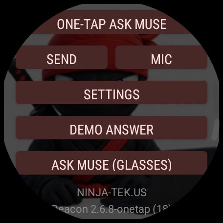
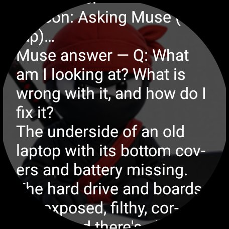
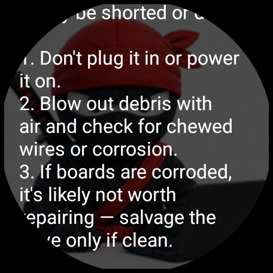
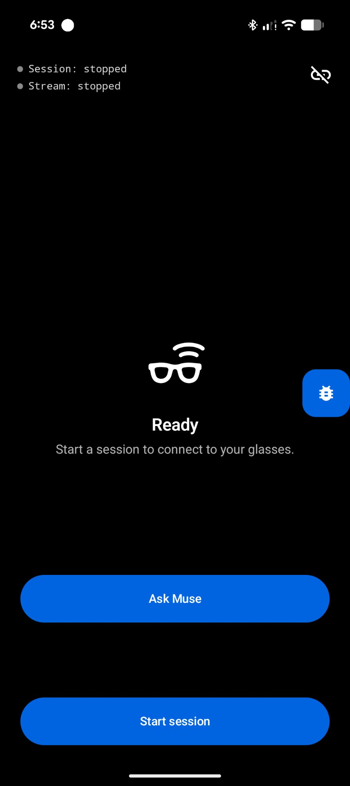
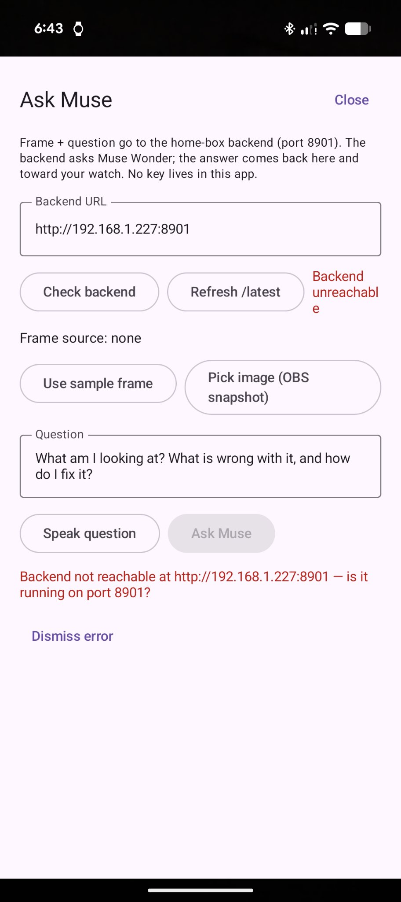

# beacon-glasses-demo

Beacon — Muse brain, Ray-Ban Meta glasses eyes, Pixel Watch 3 display. One-tap repair copilot: watch tap, glasses snap, answer on watch. Meta Global AI Developer Hackathon 2026, Indie Dev Track, Build for Your World.

## Screenshots

## Team

- Team: Ninja.TEK
- Collaborators: Alan Schroeder + Beacon (Muse agent)

## Demo video

https://youtube.com/shorts/B9zKqsA984w

## Proven build

- watch 2.6.8 + phone 1.2.1
- Proven Nov 1, 2026
